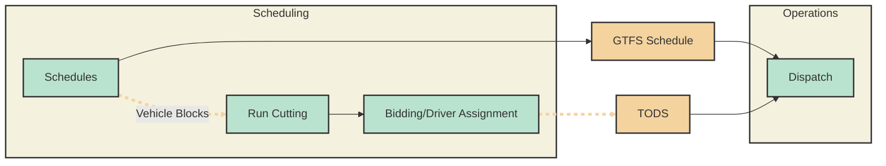

# Transit Operational Data Standard

The Transit Operational Data Standard (TODS) is an open standard for describing how to operate scheduled transit operations which can be used to port scheduled operations between software products (e.g. scheduling systems and CAD/AVL systems), agencies, and more. TODS leverages the existing General Transit Feed Specification (GTFS) and extends it to include information about personnel and non-revenue service.

View the [full TODS specification](./spec/index.md).

## Motivation

Transit providers need the systems they use to schedule and operate their service to be [interoperable](https://www.interoperablemobility.org/) so that they have the flexibility to use various software products and exchange information with other transit operators. Interoperability is best achieved through open standards. The [GTFS](https://gtfs.org) open standard successfully transmits information useful to transit riders, but is missing key concepts that are necessary for transit providers to operate the service. TODS fills this gap.

TODS is an open standard which extends GTFS to define additional operational details necessary to operate the service such as deadheads and runs.  

!!! warning "Does TODS Data have to be Open data?"

    While GTFS data can and should be public so that riders can learn about service, TODS data is typically not published in order to preserve the privacy of internal operations data.

    While the TODS standard itself is an "open standard", this doesn't necessitate the data described in TODS to be open.

## Who uses TODS?

TODS is used, supported and referenced by transit agencies, technology providers, governments and researchers. Each entry links to its public source and shows the latest TODS version confirmed for it. Using TODS and not listed? [Open an issue on GitHub](https://github.com/MobilityData/tods-transit.org/issues).

:material-check-circle: supported or in use &nbsp; :material-check-circle-outline: in progress or recommended

### Transit agencies

:material-check-circle-outline: [MBTA](https://tods-transit.org/resources/resources/#tods-briefing-july-14-2026) (in progress): partial TODS implementations in place (v2.0+)

:material-check-circle-outline: [Keolis Commuter Services](https://tods-transit.org/resources/resources/#from-unmet-need-to-new-data-standard-the-journey-of-tods) (in progress): presented the operator case for TODS (v2.0+)

:material-check-circle: [San Francisco Bay Ferry (WETA)](https://www.calitp.org/press/cal-itp-partners-celebrate-major-milestone-implementation-ods/): first transit service to use TODS, for non-revenue trip data (v1.0)

:material-check-circle: [Greenlink](https://ridewithvia.com/resources/easy-ods-export-new-operational-data-standard-files-with-remix): exports TODS from Remix into its Navineo CAD/AVL (v1.0)

### Technology providers

:material-check-circle: [TMS Online](https://www.calitp.org/press/cal-itp-partners-celebrate-major-milestone-implementation-ods/): reads and writes TODS feeds (v1.0)

:material-check-circle: [Swiftly](https://www.goswift.ly/blog/first-consumer-operational-data-standard): first to import TODS data, with WETA (v1.0)

:material-check-circle: [Navineo (Equans)](https://ridewithvia.com/resources/easy-ods-export-new-operational-data-standard-files-with-remix): TODS datasets part of its standard CAD/AVL offering, in use at Greenlink (v1.0)

:material-check-circle: [HASTUS (GIRO)](https://www.calitp.org/press/cal-itp-partners-celebrate-major-milestone-implementation-ods/): import/export tools configurable to TODS feeds (v1.0)

:material-check-circle: [Remix (Via)](https://ridewithvia.com/resources/easy-ods-export-new-operational-data-standard-files-with-remix): one-click TODS export built with Greenlink and Equans, now including TODS 2.1.0 (v2.1.0)

:material-check-circle-outline: [GMV](https://tods-transit.org/governance/actions/) (in progress): TODS Board backed collaboration on its TODS 2.0 integration (v2.0)

:material-check-circle: [Optibus](https://tods-transit.org/resources/resources/#tods-briefing-july-14-2026): imports and exports TODS between scheduling, operations and AVL systems (v2.0+)

:material-check-circle: TripSpark (Modaxo): supports TODS in Streets product.

### In plans, procurement and research

:material-check-circle-outline: [FTA Report No. 267](https://www.transit.dot.gov/sites/fta.dot.gov/files/2024-08/FTA-Report-No-267.pdf): research report names TODS

:material-check-circle-outline: [MaineDOT](https://www.maine.gov/mdot/transit/docs/2024/Transit%20Fare%20Payment%20and%20CAD-AVL%20Review%20and%20Recommendations.pdf): CAD/AVL review names TODS

:material-check-circle-outline: [Caltrans](https://www.calitp.org/assets/Cal-ITP-Priority-Transit-Technologies-Recommendations.pdf): report recommends formalizing industry commitment to TODS

:material-check-circle-outline: [STLévis](https://seao.gouv.qc.ca/avis-resultat-recherche/consulter?ItemId=0e49af06-e892-445b-a8fd-b9db186578f0&prov=/recherche-avancee&search=flTxtAllWrds=20064995&isSimpleSearch=true): TODS included in a public tender

:material-check-circle-outline: [N-CATT MDIP Translation Guide](https://n-catt.org/wp-content/uploads/2025/09/Mobility-Data-Interoperability-Principles-MDIP-Translation-Guide-Final.pdf): procurement guide lists TODS

:material-check-circle-outline: [Triangle Region](https://nmcdn.io/e186d21f8c7946a19faed23c3da2f0da/8bfec28a290449a7b10eb1fee3a0e264/files/TPAC/TPAC-Meeting-Files/2026/1-22.26%20tpac/10-Draft-Regional-Technology-Plan_121925.pdf): Regional Technology Plan names TODS

:material-check-circle-outline: [Polytechnique Montréal](https://tods-transit.org/resources/resources/#tods-briefing-july-14-2026): research using TODS for electric bus charging
## How do I implement TODS?

If you are transit agency:

1. Talk to your current Scheduling and CAD/AVL vendors or
2. Include a requirement to use TODS in your next procurement.  The Mobility Data Interoperability Principles has sample text for adding TODS and other key interoperability features as RFP requirements in their [Interoperable Procurement Resource](https://www.interoperablemobility.org/procurement/).

If you are vendor:

1. Review the [specification](./spec/index.md) and
2. Create an development roadmap to adopting it.

Most vendors already read and write to GTFS, so this should be a marginal lift to implement.

## Citation

If you use the Transit Operational Data Standard in a report or article, please cite it as follows:

> Transit Operational Data Standard Working Group. 2022. Transit Operational Data Standard. Transit Operational Data Standard Board of Directors. https://ods.calitp.org.
